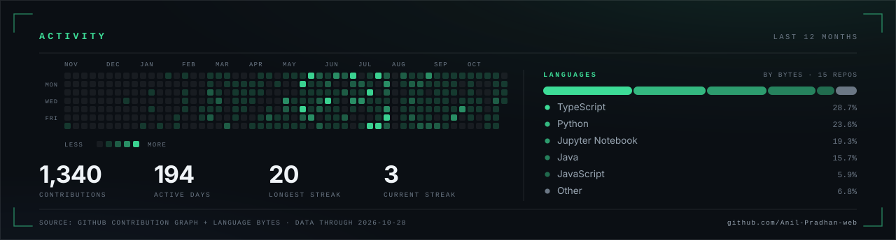

<picture>
  <source media="(max-width: 600px) and (prefers-color-scheme: dark)" srcset="./assets/hero-mobile-dark.svg">
  <source media="(max-width: 600px) and (prefers-color-scheme: light)" srcset="./assets/hero-mobile-light.svg">
  <source media="(prefers-color-scheme: light)" srcset="./assets/hero-light.svg">
  
</picture>

**Open to 2027 SDE / AI-infra roles** &nbsp;·&nbsp; Bhubaneswar, IST (UTC+5:30) 
[Résumé ↗](https://my-portfolio-anil.vercel.app/Anil_Pradhan_resume.pdf) &nbsp;·&nbsp; [Portfolio ↗](https://my-portfolio-anil.vercel.app) &nbsp;·&nbsp; [LinkedIn ↗](https://www.linkedin.com/in/anil-pradhan543/) &nbsp;·&nbsp; [Email ↗](mailto:anilpradhan9644@gmail.com)

<table align="center">
  <tr>
    <td align="center" width="25%">
      <h3>Top 6</h3>
      of <b>8,000+</b> teams Dell 2026
    </td>
    <td align="center" width="25%">
      <h3>8.93</h3>
      CGPA / 10 B.Tech CSE
    </td>
    <td align="center" width="25%">
      <h3>218+</h3>
      DSA problems <a href="https://leetcode.com/u/Anil_Pradhan/">LeetCode</a>
    </td>
    <td align="center" width="25%">
      <h3>4★</h3>
      HackerRank <a href="https://www.hackerrank.com/profile/anilpradhan9644">Java</a>
    </td>
  </tr>
</table>

## Selected work

### [AI Career Mentor](https://github.com/Anil-Pradhan-web/ai-career-mentor)

*Agentic career platform: résumé audit → live market scan → learning roadmap.*

- **Engine** — FastAPI service with a LangGraph agent graph, ChromaDB retrieval, and PostgreSQL persistence.
- **Hardening** — RBAC, token-bucket rate limiting, circuit breakers, containerised CI/CD.

[Repo ↗](https://github.com/Anil-Pradhan-web/ai-career-mentor) &nbsp;·&nbsp; [Live demo ↗](https://ai-career-mentor-anil.vercel.app)

### [TaskPilot AI](https://github.com/IdeaForg-e/TaskPilot-AI) team project

*Multi-agent chief of staff: five signal sources → one deduplicated, calendar-aware plan.*

- **Role** — integration lead: bi-directional sync across GitHub, Slack, email, and calendar.
- **Engine** — async FastAPI pipelines, idempotent state machine, Redis + PostgreSQL.

[Repo ↗](https://github.com/IdeaForg-e/TaskPilot-AI) &nbsp;·&nbsp; [Live demo ↗](https://task-pilot-ai-two.vercel.app/)

### [VisionForge AI](https://github.com/Disha-1610/VisionForge) team project

*Autonomous hardware inspection: defect detection, root-cause synthesis, vector retrieval.*

- **Dell FutureMinds 2026** — national grand finalist, **top 6 of 8,000+ teams**; pitched live at Dell Bengaluru HQ.
- **Role** — AI/ML and pipeline engineering: YOLO11n inference, OpenCV pre-processing, FAISS retrieval, &lt;5 s end to end.

[Repo ↗](https://github.com/Disha-1610/VisionForge)

**Also shipped** — [VolunteerIQ](https://github.com/Anil-Pradhan-web/VolunteerIQ) volunteer dispatch engine ([live ↗](https://volunteer-iq-clutchcode.vercel.app/)) · [SlotSync](https://github.com/Anil-Pradhan-web/SlotSync) Tatkal reservation engine in Java 23 + React 19 · [Portfolio](https://github.com/Anil-Pradhan-web/MY-PORTFOLIO) source for this site and blog.

## Stack

**Systems** — Python · Java 23 · TypeScript · SQL

**Backend & data** — FastAPI · PostgreSQL · Redis · Docker · GitHub Actions

**AI / ML** — LangGraph · RAG · FAISS · ChromaDB · Gemini · YOLO11 · OpenCV

## Activity

*Last 12 months — pulled from GitHub's own contribution graph and per-repository language bytes. Refreshed daily by CI.*

<picture>
  <source media="(max-width: 600px) and (prefers-color-scheme: dark)" srcset="./assets/activity-mobile-dark.svg">
  <source media="(max-width: 600px) and (prefers-color-scheme: light)" srcset="./assets/activity-mobile-light.svg">
  <source media="(prefers-color-scheme: light)" srcset="./assets/activity-light.svg">
  
</picture>

## Track record

- **Dell FutureMinds AI Hackathon 2026** — National Grand Finalist, **top 6 of 8,000+ teams**, on stage at Dell Bengaluru HQ.
- **Naukri Young Turks 2026** — Certificate of Merit, **96.57 percentile**.
- **iQOO Hackathon 2026 · Microsoft AI Dev Days · Amazon Nova · Google Solution Challenge** — selected builder.
- **IIT Madras Reverse Coding-X · NIT Rourkela AlgoUtsav 2026** — competitive programming.

## Writing

- [**Building AI Applications Is More Than Just Calling an LLM API**](https://my-portfolio-anil.vercel.app/blog/building-ai-applications-beyond-llm-api) — async event loops, deterministic RAG chunking, evaluation harnesses, OWASP LLM defenses.
- [**AI Layoffs and Billions in Data Centers: What Is Really Happening to Jobs?**](https://my-portfolio-anil.vercel.app/blog/ai-layoffs-data-centers-and-the-future-of-jobs) — where the compute money goes, and which roles it removes.
- [**Pollution in India: Evidence, Myths, and the Decade Ahead**](https://my-portfolio-anil.vercel.app/blog/pollution-in-india-evidence-myths-and-the-decade-ahead) — reading the data instead of the headlines.
- [**Into the Deep Sea: Earth's Last Frontier**](https://my-portfolio-anil.vercel.app/blog/into-the-deep-sea-earths-last-frontier) — abyssal telemetry, trench mapping, and what we still cannot see.

## Credentials

- **Anthropic** — Claude 101 · AI Fluency for Students & Developers
- **IBM** — Artificial Intelligence Fundamentals
- **Infosys Springboard** — Generative AI (OpenAI GPT & AI for Software Engineering)
- **Naukri.com** — Certificate of Merit, Young Turks 2026
- **Cisco Networking Academy** — Python Essentials 2

Six more, verified on LinkedIn

- **Wells Fargo** — Software Engineering Job Simulation
- **IBM** — Getting Started with Artificial Intelligence
- **HackerRank** — Problem Solving (Basic) · SQL (Basic) · Python (Basic)
- **GeeksforGeeks** — 160 Days of Problem Solving
- **IIT Madras** — Reverse Coding-X
- **NIT Rourkela** — AlgoUtsav 2026

[Portfolio](https://my-portfolio-anil.vercel.app) &nbsp;·&nbsp; [Blog](https://my-portfolio-anil.vercel.app/blog) &nbsp;·&nbsp; [LinkedIn](https://www.linkedin.com/in/anil-pradhan543/) &nbsp;·&nbsp; [LeetCode](https://leetcode.com/u/Anil_Pradhan/) &nbsp;·&nbsp; [GeeksforGeeks](https://www.geeksforgeeks.org/user/anilpradhan543/) &nbsp;·&nbsp; [Email](mailto:anilpradhan9644@gmail.com)

<b>Anil Pradhan</b> · Backend &amp; AI systems · Bhubaneswar, India

