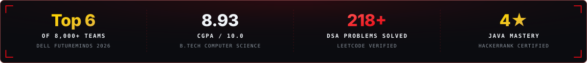

 

<b>Building real-world products and solving problems that actually matter.</b>

  

  

---

## ⚡ Core Transmission & Tech Stack

### Languages

### AI, Machine Learning & Agentic Systems

### Backend & APIs

### Frontend & Modern Web

### Data & ML Tooling

### Computer Science & Core Systems

### DevOps, Cloud & Infrastructure

---

## 🔴 Live Telemetry & GitHub Stats

  

  

  

---

## 🏆 Track Record & Hackathons

-  **National Grand Finalist, top 6 of 8,000+ teams**, on stage at Dell Bengaluru HQ.
-  **Certificate of Merit, 96.57 percentile**.
-  **iQOO Hackathon 2026 · Microsoft AI Dev Days · Amazon Nova · Google Solution Challenge**.
-  **IIT Madras Reverse Coding-X · NIT Rourkela AlgoUtsav 2026**.

---

## ✍️ Articles & Technical Blog

Explore my technical articles and essays on AI systems, scalable backends, and computing:

 

---

## 📜 Clearance & Credentials

-  **Claude 101** · AI Fluency for Students & Developers
-  **Artificial Intelligence Fundamentals**
-  **Generative AI** (OpenAI GPT & AI for Software Engineering)
-  **Certificate of Merit**, Young Turks 2026
-  **Python Essentials 2**

Six more, verified on LinkedIn

 

-  **Software Engineering Job Simulation**
-  **Getting Started with Artificial Intelligence**
-  **Problem Solving (Basic) · SQL (Basic) · Python (Basic)**
-  **160 Days of Problem Solving**
-  **Reverse Coding-X**
-  **AlgoUtsav 2026**

---

  

<b>Anil Pradhan</b> · Backend &amp; AI systems · Bhubaneswar, India

  

