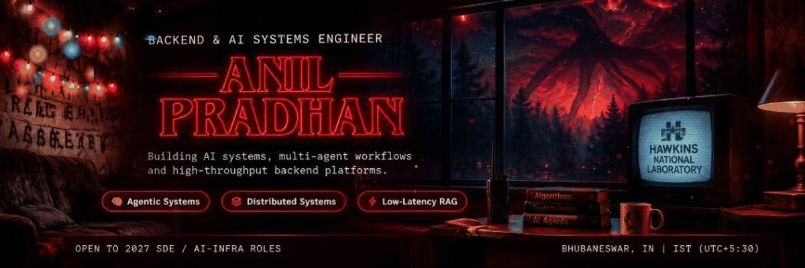

 

<b>HAWKINS NATIONAL LABORATORY // AGENTIC SYSTEMS DIVISION</b> 
<b>Open to 2027 SDE / AI-infra roles</b> &nbsp;·&nbsp; Bhubaneswar, IST (UTC+5:30) 
[Résumé ↗](https://my-portfolio-anil.vercel.app/Anil_Pradhan_resume.pdf) &nbsp;·&nbsp; [Portfolio ↗](https://my-portfolio-anil.vercel.app) &nbsp;·&nbsp; [LinkedIn ↗](https://www.linkedin.com/in/anil-pradhan543/) &nbsp;·&nbsp; [Email ↗](mailto:anilpradhan9644@gmail.com)

<table align="center">
  <tr>
    <td align="center" width="25%">
      <h3>Top 6</h3>
      of <b>8,000+</b> teams Dell 2026
    </td>
    <td align="center" width="25%">
      <h3>8.93</h3>
      CGPA / 10 B.Tech CSE
    </td>
    <td align="center" width="25%">
      <h3>218+</h3>
      DSA problems <a href="https://leetcode.com/u/Anil_Pradhan/">LeetCode</a>
    </td>
    <td align="center" width="25%">
      <h3>4★</h3>
      HackerRank <a href="https://www.hackerrank.com/profile/anilpradhan9644">Java</a>
    </td>
  </tr>
</table>

---

## ⚡ Core Transmission & Tech Stack

### Languages

### AI / ML & Agentic Systems

### Backend & Distributed Systems

### Frontend & Frameworks

### DevOps, Cloud & Infrastructure

---

## 🔴 Live Telemetry & GitHub Stats

  

  

  

---

## 🏆 Track Record & Hackathons

- **Dell FutureMinds AI Hackathon 2026** — National Grand Finalist, **top 6 of 8,000+ teams**, on stage at Dell Bengaluru HQ.
- **Naukri Young Turks 2026** — Certificate of Merit, **96.57 percentile**.
- **iQOO Hackathon 2026 · Microsoft AI Dev Days · Amazon Nova · Google Solution Challenge** — selected builder.
- **IIT Madras Reverse Coding-X · NIT Rourkela AlgoUtsav 2026** — competitive programming.

---

## ✍️ Articles & Technical Blog

Explore my technical articles and essays on AI systems, scalable backends, and computing:  
👉 **[Read all articles on my Blog ↗](https://my-portfolio-anil.vercel.app/blog)**

---

## 📜 Clearance & Credentials

- **Anthropic** — Claude 101 · AI Fluency for Students & Developers
- **IBM** — Artificial Intelligence Fundamentals
- **Infosys Springboard** — Generative AI (OpenAI GPT & AI for Software Engineering)
- **Naukri.com** — Certificate of Merit, Young Turks 2026
- **Cisco Networking Academy** — Python Essentials 2

Six more, verified on LinkedIn

- **Wells Fargo** — Software Engineering Job Simulation
- **IBM** — Getting Started with Artificial Intelligence
- **HackerRank** — Problem Solving (Basic) · SQL (Basic) · Python (Basic)
- **GeeksforGeeks** — 160 Days of Problem Solving
- **IIT Madras** — Reverse Coding-X
- **NIT Rourkela** — AlgoUtsav 2026

---

[Portfolio](https://my-portfolio-anil.vercel.app) &nbsp;·&nbsp; [Blog](https://my-portfolio-anil.vercel.app/blog) &nbsp;·&nbsp; [LinkedIn](https://www.linkedin.com/in/anil-pradhan543/) &nbsp;·&nbsp; [LeetCode](https://leetcode.com/u/Anil_Pradhan/) &nbsp;·&nbsp; [GeeksforGeeks](https://www.geeksforgeeks.org/user/anilpradhan543/) &nbsp;·&nbsp; [Email](mailto:anilpradhan9644@gmail.com)

<b>Anil Pradhan</b> · Backend &amp; AI systems · Bhubaneswar, India

