<!-- ── Animated Terminal Hero Banner (Theme-Aware) ── -->

 

<!-- ── Live Metrics Badges ── -->

  
  &nbsp;
  
  &nbsp;
  

<!-- ── Dynamic Telemetry Typing ── -->

 

## 👋 Executive Summary

I am a **Software Engineer specializing in Backend Infrastructure & Autonomous AI Systems**. I focus on turning experimental multi-agent interactions into **deterministic, reproducible, and production-hardened software**.

- 🏛️ **Core Focus:** Multi-agent state machines, event-driven microservices, RAG pipelines, and high-throughput API gateways.
- 🥇 **Distinction:** **National Grand Finalist (Top 6 / 8,000+ Contenders)** at the *Dell FutureMinds AI Hackathon 2026*, pitching live at Dell Technologies Bengaluru HQ.
- 🎓 **Education:** B.Tech in Computer Science & Engineering (Batch 2024–2028 · **CGPA: 8.93 / 10**).
- 📍 **Location:** Bhubaneswar, India (Open to high-impact distributed and global opportunities).
- 📬 **Direct Contact:** [anilpradhan.dev@gmail.com](mailto:anilpradhan.dev@gmail.com) · [LinkedIn Profile](https://www.linkedin.com/in/anil-pradhan543/) · [Personal Portfolio](https://my-portfolio-anil.vercel.app)

---

## 🚀 Featured Flagship Architectures

<table>
  <tr>
    <td width="50%" valign="top">
      <h3>🔍 VisionForge AI</h3>
      
<b>Autonomous Hardware Vision Inspection &amp; Anomaly Detection</b>

      
<i>National Grand Finalist Architecture pitched live at Dell Technologies Bengaluru HQ.</i>

      <ul>
        <li><b>Engine:</b> YOLO11n + LangGraph multi-agent DAG + OpenCV + FAISS vector search.</li>
        <li><b>Performance:</b> End-to-end defect detection, classification, and vector retrieval in <b>&lt; 5 seconds</b>.</li>
        <li><b>Architecture:</b> Automated root-cause synthesis pipeline powered by Google Gemini multimodal inference.</li>
      </ul>
      

        
        
        
        
      

    </td>
    <td width="50%" valign="top">
      <h3>🤖 TaskPilot AI</h3>
      
<b>Autonomous Multi-Agent Workflow &amp; Task Orchestrator</b>

      
<i>Deterministic cross-platform execution engine eliminating human coordination overhead.</i>

      <ul>
        <li><b>Integrations:</b> Bi-directional synchronization across GitHub Issues, Slack events, Email, and Google Calendar.</li>
        <li><b>State Engine:</b> Fault-tolerant state machines with automatic retry, rollbacks, and idempotency guarantees.</li>
        <li><b>Backend:</b> Asynchronous event queues on FastAPI, Redis caching, and persistent PostgreSQL WAL logging.</li>
      </ul>
      

        
        
        
        
      

    </td>
  </tr>
  <tr>
    <td width="50%" valign="top">
      <h3>💼 AI Career Mentor</h3>
      
<b>Autonomous Career Transition &amp; Evaluation Platform</b>

      
<i>Agentic pipeline auditing resumes, scraping live hiring indices, and generating dynamic learning roadmaps.</i>

      <ul>
        <li><b>Agent Graph:</b> Resume Auditor Agent &#x2192; Market Scraper Agent &#x2192; Roadmap Compiler &#x2192; Interview Evaluator.</li>
        <li><b>RAG Engine:</b> Semantic document chunking with ChromaDB embeddings and contextual reranking.</li>
        <li><b>Security:</b> Strict RBAC authorization, token-bucket rate limiting, and OWASP defense guards.</li>
      </ul>
      

        
        
        
        
      

    </td>
    <td width="50%" valign="top">
      <h3>🌐 VolunteerIQ</h3>
      
<b>Intelligent Community Coordination Platform</b>

      
<i>Resource matching engine optimizing non-profit volunteer dispatch and real-time operational response.</i>

      <ul>
        <li><b>Matching:</b> Algorithmic skill-to-need allocation maximizing community response velocity.</li>
        <li><b>Frontend:</b> Responsive dashboard built with TypeScript, Next.js, and modern Tailwind CSS design tokens.</li>
        <li><b>Cloud Native:</b> Automated CI/CD deployment pipelines managed through GitHub Actions.</li>
      </ul>
      

        
        
        
        
      

    </td>
  </tr>
</table>

---

## 🏆 National Competitions & Hackathons

  

---

## ⚡ Technical Architecture // Skill Matrix

  

---

## 🧠 Algorithmic Rigor & Problem Solving

<table border="0" cellspacing="10" cellpadding="0">
  <tr>
    <td align="center">
      
    </td>
    <td align="center">
      
    </td>
    <td align="center">
      
    </td>
  </tr>
</table>

---

## 📊 Telemetry & Contribution Activity

<!-- GitHub Stats Grid -->
<table border="0" cellspacing="6">
  <tr>
    <td align="center">
      
    </td>
    <td align="center">
      
    </td>
  </tr>
  <tr>
    <td colspan="2" align="center">
      
    </td>
  </tr>
</table>

 

<!-- Contribution Snake Animation (Always Active & Theme-Adaptive) -->

---

## 📜 Verified Credentials & Honors

<table>
  <tr>
    <td width="50%" valign="top">
      <h4>🤖 Frontier AI &amp; Generative Systems</h4>
      <ul>
        <li><b>Anthropic</b> &#x2014; Claude 101 Certification</li>
        <li><b>Anthropic</b> &#x2014; AI Fluency for Students &amp; Developers</li>
        <li><b>IBM</b> &#x2014; Getting Started with Artificial Intelligence</li>
        <li><b>IBM</b> &#x2014; Artificial Intelligence Fundamentals</li>
        <li><b>Infosys Springboard</b> &#x2014; Generative AI (OpenAI GPT &amp; AI for SWE)</li>
      </ul>
    </td>
    <td width="50%" valign="top">
      <h4>⚙️ Enterprise SWE &amp; Competitive Merit</h4>
      <ul>
        <li><b>Naukri.com</b> &#x2014; Certificate of Merit: Young Turks 2026 (<b>96.57 Percentile</b>)</li>
        <li><b>Wells Fargo</b> &#x2014; Software Engineering Job Simulation</li>
        <li><b>Cisco Networking Academy</b> &#x2014; Python Essentials 2</li>
        <li><b>IIT Madras &amp; NIT Rourkela</b> &#x2014; Reverse Coding-X &amp; AlgoUtsav 2026</li>
        <li><b>HackerRank</b> &#x2014; Problem Solving (Basic), SQL (Basic), Python (Basic)</li>
        <li><b>GeeksforGeeks</b> &#x2014; 160 Days of Problem Solving Streak</li>
      </ul>
    </td>
  </tr>
</table>

  

---

## ✍️ Architectural Research & Publications

I author long-form technical dispatches analyzing distributed systems, deterministic AI state models, and systems engineering at [**my-portfolio-anil.vercel.app/blog**](https://my-portfolio-anil.vercel.app/blog):

<table>
  <tr>
    <td width="25%" align="center"><b>🌊 Deep Sea &amp; Oceans</b> Abyssal telemetry &amp; trench sensory data</td>
    <td width="25%" align="center"><b>🌿 Nature &amp; Ecology</b> Canopy resilience &amp; biological indicators</td>
    <td width="25%" align="center"><b>🤖 Technology &amp; AI</b> Multi-agent state machines &amp; backend scale</td>
    <td width="25%" align="center"><b>📈 Economics &amp; Society</b> Labor automation &amp; infrastructural shifts</td>
  </tr>
</table>

> 📖 **Featured Essay:** [***Building AI Applications Is More Than Just Calling an LLM API***](https://my-portfolio-anil.vercel.app/blog/building-ai-applications-beyond-llm-api) &#x2014; An architectural deep-dive into asynchronous FastAPI event loops, deterministic RAG chunking algorithms, automated evaluation harnesses, and OWASP Top 10 for LLM defenses.

---

## 🌐 Command Hub & Connect

  
  &nbsp;
  
  &nbsp;
  
  &nbsp;
  
  &nbsp;
  

 

<b>Architected &amp; Engineered by Anil Pradhan</b> &#x2022; <i>Deterministic Intelligence for Complex Human &amp; Machine Systems.</i>

  

